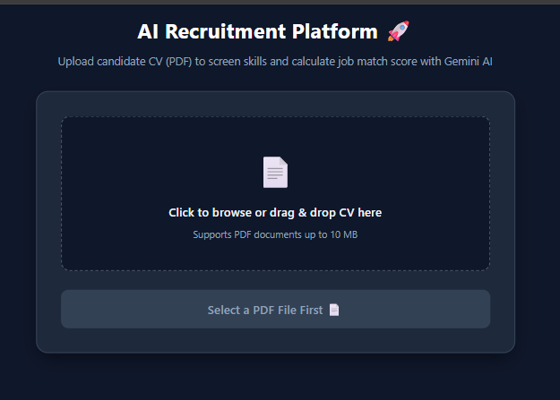
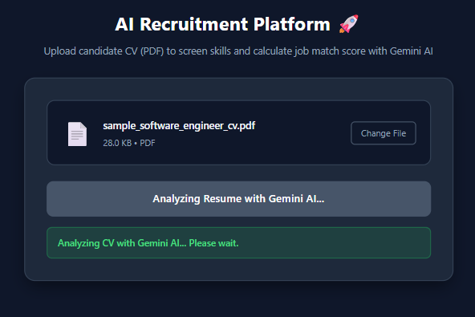
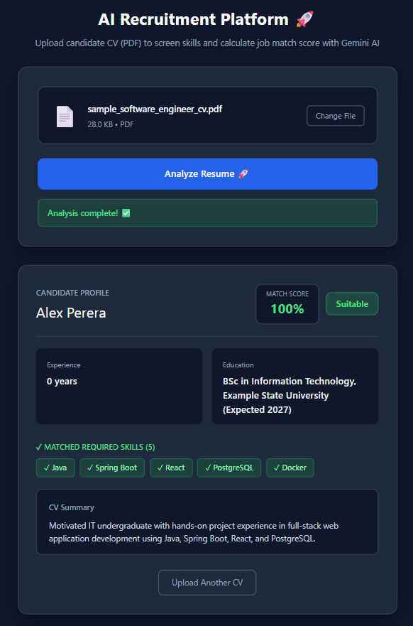

# 🤖 AI Recruitment Platform

An AI-powered recruitment platform that analyzes candidate CVs and evaluates their suitability for a target job description using Google Gemini AI.

🔗 **Repository:** [https://github.com/MaheeshaPaboth/AI-Recruitment-Platform](https://github.com/MaheeshaPaboth/AI-Recruitment-Platform)

---

## ✨ Features

- **PDF CV Upload:** Drag-and-drop or browse PDF documents (up to 10 MB).
- **Automatic Text Extraction:** High-performance text parsing with PyPDF.
- **AI-Powered Evaluation:** In-depth analysis powered by the Google Gemini API.
- **Skill Extraction & Matching:** Automatically identifies required and matched technical skills.
- **Objective Job Match Score:** Real-time percentage scoring and suitability recommendation (*Suitable* / *Not Suitable*).
- **Structured JSON Schema:** Reliable, consistent AI outputs.
- **Modern Responsive UI:** Built with Next.js, React, TypeScript, and modern dark-mode styling.

---

## 📸 Screenshots

### 1. CV Upload Interface
The candidate can easily browse or drag and drop a PDF CV for instant screening.



### 2. Real-Time AI Analysis
The system securely processes the document and generates recruitment insights.



### 3. Candidate Evaluation & Match Score Results
The platform displays the candidate's name, experience, education, job match percentage, matched vs. missing skills, and an executive CV summary.



---

## 🛠️ Technology Stack

| Area | Technologies |
|---|---|
| **Frontend** | Next.js 16 (Turbopack), React 19, TypeScript, Tailwind CSS |
| **Backend** | Python 3.13, FastAPI, Pydantic, Uvicorn |
| **AI & Document Processing** | Google Gemini API (`google-genai`), PyPDF |
| **Architecture** | REST API, Structured JSON Schema, CORS |

---

## 🏗️ Architecture

1. The user uploads a CV in PDF format through the Next.js frontend.
2. FastAPI receives the uploaded document.
3. PyPDF extracts and cleans text from the PDF.
4. The extracted CV text and target job requirements are sent to Gemini AI.
5. Gemini evaluates the candidate's experience, education, and skills against the job requirements.
6. The backend normalizes skills and calculates the final match score and suitability recommendation.
7. The frontend displays the candidate profile, score gauge, matched skills badges, and summary.

---

## 🚀 Getting Started

### Prerequisites

- Python 3.10+
- Node.js 18+ and npm
- A [Google Gemini API Key](https://aistudio.google.com/)

---

### 1. Clone the repository

```bash
git clone https://github.com/MaheeshaPaboth/AI-Recruitment-Platform.git
cd AI-Recruitment-Platform
```

---

### 2. Start the Backend (FastAPI)

Open a terminal:

```powershell
cd backend
python -m venv venv
```

Activate the virtual environment:

**Windows (PowerShell):**
```powershell
.\venv\Scripts\Activate.ps1
```

**macOS / Linux:**
```bash
source venv/bin/activate
```

Install the dependencies:

```bash
pip install -r requirements.txt
```

Create a `.env` file using `.env.example`, then add your Gemini API key:

```env
GEMINI_API_KEY=your_gemini_api_key_here
GEMINI_MODEL=gemini-3.5-flash
GEMINI_FALLBACK_MODEL=gemini-3.5-flash-lite
```

Start the FastAPI server:

```bash
python -m uvicorn main:app --reload
```

- **Backend API:** `http://localhost:8000`
- **Swagger Docs:** `http://localhost:8000/docs`

---

### 3. Start the Frontend (Next.js)

Open a second terminal:

```bash
cd ai-platform-ui
npm install
npm run dev
```

- **Frontend Application:** `http://localhost:3000`

---

## 👨‍💻 Developer

**Maheesha Paboth Adikari**  
Information Technology Undergraduate  
University of Moratuwa, Sri Lanka  

*Currently seeking a Software Engineering Internship.*

- **GitHub:** [@MaheeshaPaboth](https://github.com/MaheeshaPaboth)
- **LinkedIn:** [Maheesha Paboth](https://www.linkedin.com/in/maheesha-paboth-23549a2b5/)
- **Email:** [maheesha1111@gmail.com](mailto:maheesha1111@gmail.com)

---

## 📄 License

This project is developed for educational and portfolio purposes.
